# tasu-tasuku

## Language Distribution / 言語の内訳

  

## Skills / スキル
### Programming / プログラミング言語

### Tools / ツール

### Documentation / ドキュメント作成

## Contributions / コントリビューション

### Translation / 翻訳

- **[Cboard](https://github.com/cboard-org/cboard)** — Translating this open-source AAC app into Japanese on Crowdin 
  オープンソースの AAC(コミュニケーション支援)アプリ Cboard の日本語翻訳に Crowdin で参加しています
